# Implementation Plan: Fresh Control Tower

> **Group 1 · AI for Inventory Management** · SP Jain School of Global Management, MAIB · AI in Operations
> **Version 1.1 · 13 Nov 2026 · Status: APPROVED by the lead on 13 Nov 2026, with the audit revisions in §17 applied**
> **Inputs:**
> - [docs/01-problem-selection.md](docs/01-problem-selection.md): the approved problem;
> - [docs/02-dataset-selection.md](docs/02-dataset-selection.md): the datasets;
> - [docs/03-data-inspection.md](docs/03-data-inspection.md): the inspection findings.
>
> **Change control.** Once approved, this plan, the design system (§6.4) and the data contracts (§2.4) can only change through a logged change request in `docs/decisions/`.

---

## 0. Plan on a page

- **What we build.** A prototype that shows how AI stops a UAE fresh-grocery operator from wasting food and losing sales at the same time. It does this by:
  - recovering hidden demand;
  - forecasting demand as a range;
  - deciding how much to order and how early;
  - choosing suppliers under disruption.
- **The prototype.** One dashboard (Next.js) with seven pages and a single global **Scenario Console**. Every scenario (order volumes, spikes, festivals, disruption, policy) is an option on the same shared state.
- **Data.**
  - **REAL:** FreshRetailNet-50K and -LT (stockouts) and the Kaggle vegetables data (prices, costs, spoilage, festival and spike shapes).
  - **CALIBRATED SYNTHETIC:** a UAE layer covering Jan 2023 to Oct 2026, built from the real data with a known true demand.
  - Every number in the dashboard and the report carries its provenance tag.
- **Where computation runs.** All heavy work (cleaning, calibration, generation, training, backtests) runs offline in Python on team laptops and is exported as **precomputed** JSON. The browser does only light, interactive work (the scenario simulation, TOPSIS and the live replay). The host serves **static files only**, on Vercel Hobby (free).
- **Build order.** Nine Phase 5 parts on two parallel tracks: Python (Parts 1–4) and Web (Parts 5–9). The tracks are connected only by the data contracts, so teammates can build in parallel without editing the same files.
- **Outputs.** The LaTeX report (9 main sections, matching 9 slides), the NotebookLM prompt and the collaboration kit.

---

## 1. Problem statement and success criteria

### 1.1 Problem statement (approved 13 Nov 2026)

> A UAE fresh-grocery and quick-commerce operator (a fictional composite) loses money at both ends of the shelf: fresh food spoils while customers find empty shelves. Its replenishment system learns from sales, but sales stop when stock runs out. So true demand at the busiest moments (Ramadan, Eid, weekends, sudden surges) is never recorded, and the system keeps under-ordering. Since the 2026 Hormuz shipping disruption, fresh lead times have also become longer and less predictable. We propose an AI replenishment engine that:
> - recovers hidden demand;
> - forecasts demand as a range;
> - decides how much to order and how early;
> - ranks suppliers on cost, freshness, reliability, disruption risk and carbon.
>
> All of this is shown in one scenario-driven control tower.

- **Client.** "The Operator", a fictional composite running about 8 dark stores across Dubai, Sharjah and Abu Dhabi. Its name is still open (Q5 in §15). Any name must be checked against real UAE businesses and labelled *fictional*.
- **Product working title.** Fresh Control Tower. It can be renamed through a change request.

### 1.2 Success criteria

Targets are **hypotheses to test**. Whatever the outcome, the results will be reported honestly.

| Area | Criterion | Target | How it is measured |
|---|---|---|---|
| Business (synthetic backtest, test window Jan–Oct 2026) | Lost sales (unmet true demand) vs the legacy baseline | ≥ 30% lower | Monte Carlo backtest (§4.5), median of 200 runs |
| | Waste (kg spoiled) vs baseline | ≥ 20% lower, **at the same time** as the lost-sales reduction | Same |
| | Total cost (lost margin + waste + holding + expediting) | Lower than baseline in every stress window | Same, split by window |
| | Value attributable to real-time visibility (KQ3) | AI-Intraday beats AI-Daily on stockout hours | Policy ladder (§4.5) |
| Model (real data) | Forecast bias from censoring | Naive bias reproduced in the paper's direction (about −7%), then cut to within ±2% after recovery. Recovery accuracy is reported against the paper's best masked-recovery WAPE (27.6%, TimesNet). | FreshRetailNet-50K masking test (§3.5) |
| Model (synthetic) | Accuracy of recovered demand | Weighted absolute percentage error (WAPE) on stockout hours ≤ 25%; bias within ±3% | Comparison against known true demand |
| | Forecast quality | WAPE better than seasonal-naive and moving average; the P10–P90 band covers 75–85% of outcomes | Time-based holdout |
| | Spike detection | Median detection delay ≤ 4 trading hours; false alarms ≤ 1 per store-week | Labelled synthetic spikes |
| Decision method | AHP consistency | Consistency ratio < 0.10 for the default matrix | Unit test |
| | Rank stability | Top supplier stable within ±20% weight perturbation, or the reversal is shown | Sensitivity analysis |
| Prototype | Quality | Zero console errors on every page (production build); responsive from 375 px to 1440 px | Playwright (§9) |
| | Speed | Lighthouse Performance ≥ 90 on desktop; scenario recompute under 150 ms (p95) | Lighthouse; in-app timer |
| | Honesty | 100% of charts and figures carry a provenance tag | Playwright check + review |
| Deliverables | Coverage | Every scope bullet, key question and board theme is mapped (§13) | Traceability review |
| | Deck | 8–9 slides from the report via a NotebookLM prompt of ≤ 500 characters | Phase 7 |

**Metric conventions (used everywhere):**
- WAPE = Σ|ŷ − y| / Σy.
- Bias (weighted percentage error, WPE) = Σ(ŷ − y) / Σy. A **negative value means under-forecasting**, the same sign convention as the paper's −7.37%.

---

## 2. System architecture

### 2.1 Overview

```mermaid
flowchart LR
  subgraph RAW["Datasets/ (REAL, gitignored)"]
    A1[FreshRetailNet-50K]
    A2[FreshRetailNet-LT]
    A3[Kaggle vegetables]
  end
  subgraph EXT["data/external (REAL, committed, small)"]
    E1[UAE festival calendar + sources]
    E2[Open-Meteo UAE weather]
    E3[DESNZ 2025 transport factors]
    E4[FoodKeeper shelf lives]
    E5[Food emission factors]
  end
  subgraph PY["pipeline/ (Python, runs on team laptops)"]
    P1[Clean + calibrate] --> P2[Generate synthetic UAE world]
    P2 --> P3[Baseline policy simulation = censored history]
    P3 --> P4[Demand recovery + quantile forecasts]
    P4 --> P5[Optimisation + MCDM + Monte Carlo backtests]
    P5 --> P6[Export precomputed JSON artefacts]
  end
  subgraph WEB["web/ (Next.js static site)"]
    W1[Zod-validated data loaders] --> W2[Shared scenario state]
    W2 --> W3[TS scenario engine in a Web Worker]
    W2 --> W4[TOPSIS/AHP live]
    W2 --> W5[Live feed replay]
    W3 & W4 & W5 --> W6[7 pages + Scenario Console]
  end
  RAW --> P1
  EXT --> P1
  EXT --> P2
  P6 -->|web/public/data/*.json| W1
  WEB -->|git push| V[Vercel Hobby, static hosting]
```



### 2.2 Where each computation runs

| Computation | Runs on | Output | Label | Why there |
|---|---|---|---|---|
| Cleaning the real datasets (~13.7M rows, ~490 MB in total) | Team laptop, Python | `data/interim/*.parquet` (gitignored) | n/a | Too large and slow for a free host. Runs once. |
| Calibration (stockout curves, festival and spike shapes, markups, spoilage) | Laptop | `data/processed/calibration.json` (**committed**) | REAL-derived | Lets teammates without raw data still run generation |
| Fetching UAE weather and compiling the calendar and factors | Laptop (one-off fetch) | `data/external/*` (committed) | REAL | Public sources, cached for reproducibility |
| Generating the synthetic UAE world (8 stores × 40 SKUs × 1,400 days, hourly) | Laptop | `data/synthetic/*.parquet` (gitignored, regenerated from seed) | CALIBRATED SYNTHETIC | About 10.8M hourly steps. Vectorised NumPy runs in minutes. |
| Baseline policy simulation (creates the censored "history") | Laptop | Ledger and recorded sales | CALIBRATED SYNTHETIC | Same |
| Training demand recovery and quantile forecasts | Laptop (Colab as fallback) | Model metrics, forecast quantiles | PRECOMPUTED | The brief bans heavy training on the host. Tree models train in minutes on CPU. |
| Real-data validation (masking test on FRN-50K) | Laptop | `realdata.json` | REAL / PRECOMPUTED | Needs the full 50K dataset |
| Monte Carlo backtests (4 policies × stress windows × 200 runs) | Laptop | `backtest.json`, `frontier.json`, `impact.json` | PRECOMPUTED | CPU-heavy, done once per release |
| Interactive scenario simulation (one store-SKU, 35-day horizon, deterministic plus 50 Monte Carlo runs) | **Browser** (Web Worker) | KPIs, stock-in/stock-out ledger, order-by dates | SCENARIO | Instant feedback with no server cost. Small enough to run in under 150 ms. |
| AHP weights, TOPSIS ranking, sensitivity | **Browser** (plus a Python reference for tests) | Live rankings | SCENARIO | Trivial compute that reacts to sliders |
| Spike detector on the live replay | **Browser** | Alerts | SIMULATED FEED | Gives a real-time feel; the logic is shared with Python tests |
| "Real-time" feed | **Browser** timer over a precomputed hourly stream | Ticking store × SKU grid | SIMULATED FEED | Honest simulation of visibility |
| Hosting | Vercel Hobby (static) | Website | n/a | Free, GitHub-integrated, preview deploys per pull request |

### 2.3 Technology stack

Versions are the latest checked on 13 Nov 2026. Exact pins are set in Phase 4.

| Layer | Choice | Version | Why |
|---|---|---|---|
| Web framework | Next.js (App Router), **static export** (`output: 'export'`) | 16.4.x | Required by the brief. Static export means zero server compute and portable hosting. |
| UI runtime | React and TypeScript (strict) | 19.3.x / 5.x | Required |
| Motion | **Motion** (the current package name of Framer Motion; `framer-motion` is the same release) | 14.14.x | Required (Framer Motion) |
| WebGL | React Three Fiber, drei, three | 9.8 / 10.7 / 0.187 | **Used once**, for the supply-route globe, where geography carries meaning (§6.3) |
| Charts | Recharts for standard charts, plus d3-scale/d3-shape for the custom signature visuals | 3.10 / 4.x | Fast to build. Custom SVG where the standard library can't express the idea. |
| Styling | Tailwind CSS with CSS variables (design tokens) | 4.3.x | Speed and consistency. Tokens make the theme single-source. |
| State | Zustand, synced to URL query parameters | 5.1.x | One shared scenario state (requirement R5). Scenarios can be shared as links. |
| Contracts | Zod schemas, with JSON Schema exported for Python | 4.6.x | Pipeline and web agree on shapes, and contracts are checked in CI |
| Python | 3.11 with pandas, pyarrow, NumPy, SciPy, scikit-learn, statsmodels | Pinned in `requirements.txt` | Already installed locally. Only a few dependencies are added (LightGBM is optional). |
| Tests | pytest, Vitest, Playwright, axe-core | 5.1 / 1.65 / 4.14 | §9 |
| CI | GitHub Actions | n/a | Lint, type check, tests and build on every pull request |

**Static-export rules.** These follow from `output: 'export'`:
- no API routes, middleware, rewrites, redirects or ISR;
- `next/image` uses `images.unoptimized: true`;
- any component that calls `useSearchParams` (the URL-synced scenario state) must sit inside a `<Suspense>` boundary;
- `next start` cannot serve an export, so local and e2e testing serve the `out/` folder with a small static server.

### 2.4 Data contracts (frozen at Phase 4; changes need a change request)

All runtime artefacts live in `web/public/data/`. Test-only golden cases live in `web/tests/fixtures/golden/` and are never shipped. Every file:
- carries `contractVersion`, `generatedAt`, `generator` and `seed`;
- has a `provenance` field per series or record, taking one of `REAL | CALIBRATED_SYNTHETIC | SCENARIO | SIMULATED_FEED | DERIVED | PRECOMPUTED`;
- carries **`isFixture`**. If any loaded file is a fixture, the UI shows a persistent **"PLACEHOLDER DATA"** banner, and the screenshot script refuses to run, so placeholder numbers can never be presented as results.

**Conventions:**
- Timestamps are local **Asia/Dubai** time (UTC+4, no daylight saving).
- Money is in AED.
- Quantities are in each SKU's sales unit; `kgPerUnit` converts them to kg for waste and CO2e.

| File | Contents (key fields) | Producer → consumer |
|---|---|---|
| `meta.json` | Version, seed, sources list, provenance legend, generation timestamp | WP5 → all pages |
| `catalog.json` | `stores[]` (id, area, emirate, lat/lon); `skus[]` (id, name, category, unit, kgPerUnit, shelfLifeDays, unitCostAED, priceAED, casePack, primarySupplierId); `categories[]`; **`heroSeries[]`**, the 40 store-SKU pairs (4 stores × 10 SKUs) that have series files. The Scenario Console picker offers only these. | WP3 → all |
| `calendar.json` | `days[]` (date, weekday, isWeekend, festival, festivalPhase, ramadanDay, publicHoliday, schoolHoliday); `festivals[]` with source URL | WP2 → Demand, Scenarios |
| `weather.json` | Daily max/mean temperature and precipitation per emirate (REAL) | WP2 → Demand |
| `series/{store}__{sku}.json` | Daily rows: `trueDemand` (synthetic only), `recordedSales`, `recoveredDemand`, `fcP10/P50/P90`, `stockoutHours`, `receipts`, `sales`, `waste`, `onHandClose`, `promo`. Plus an `engine{}` block: planning-horizon quantiles, lead times, costs, shelf life. | WP4/5 → Demand, Scenarios (lazy-loaded; about 40 hero series) |
| `live/feed.json` | Hourly stream for a 14-day window (10–23 Mar 2026), 2 stores × 10 SKUs: on-hand, sales, receipts, alerts, purchase orders | WP5 → Live Ops |
| `backtest.json` | For each window (normal, Ramadan 2026, stockpiling spike, Hormuz, summer) × policy (P0–P3): KPIs with P10/P50/P90 | WP5 → Overview, Impact |
| `frontier.json` | Service target vs waste %, availability % and total cost, for baseline and AI | WP5 → Impact |
| `realdata.json` | REAL results: stockout-by-hour curve, censoring evidence, masking-test bias and WAPE, comparison with the paper | WP4 → Demand, Overview |
| `ablation.json` | Feature-group contribution (change in WAPE and bias) for KQ2 | WP4 → Demand, Roadmap |
| `mcdm.json` | Criteria (id, type benefit/cost, unit), default AHP matrix, entropy weights, `suppliers[]` with metrics, scenario adjustments | WP5 → Sourcing |
| `routes.json` | Origins, UAE ports and hubs, chokepoints, route polylines | WP2/5 → Sourcing |
| `impact.json` | Annualised cost waterfall, waste kg, CO2e, food-rescue kg (labelled synthetic) | WP5 → Impact |
| `web/tests/fixtures/golden/engine_cases.json` (test-only, not shipped; its schema is defined in Part 4) | Python reference outputs, using a shared seeded PRNG (mulberry32) implemented identically in Python and TypeScript, for parity tests | WP5 → WP9 tests |

**Phase 4 commits:**
- the Zod schemas (`web/src/lib/contracts/*.ts`);
- the exported JSON Schemas (`docs/contracts/*.schema.json`);
- **small valid fixture files**, so the web track can start before the pipeline delivers.

### 2.5 Shared scenario state (requirement R5)

There is one Zustand store, URL-synced and readable by every page:

| Group | Fields |
|---|---|
| `selection` | `storeId`, `skuId`, `category`, `dateWindow` |
| `demand` | `ordersPerDay` (absolute level for the selected store-SKU, default = forecast median) and `demandMultiplier` (0.5×–3×) |
| `spike` | `enabled`, `date`, `magnitude` (1.2×–5×, default 2.5×), `durationDays`, `warningDays` (0 = unannounced) |
| `calendar` | `ramadanIntensity` (0–150% of the calibrated value), `eidIntensity`, `nationalDay`, `summerSeason` |
| `weather` | `heatwave` (off/on, +°C) |
| `supply` | `disruptionPreset` (`none`, `hormuz2026`), `seaLeadTimeMultiplier`, `reliabilityDrop`, `freightIncrease`, `supplierOutage` |
| `policy` | `policy` (P0 Baseline, P1 AI-Daily, P2 AI-Intraday, P3 AI-Intraday + Smart Sourcing), `serviceTarget` (auto = optimised, or manual), `useDemandRecovery`, `manualOrderOverride` (stock-in what-if), `foodRescue` (on/off) |
| `sourcing` | `weightMode` (AHP/entropy/custom), `weights{}` |
| `ui` | `liveSpeed`, `tableView`, `reducedMotion` |

---

## 3. Data and ML approach

### 3.1 Data layers

1. **REAL.** The three datasets, plus UAE weather, the festival calendar, emission factors and shelf-life guidance.
2. **CALIBRATED SYNTHETIC.** A UAE world whose parameters come from layer 1 and from cited Gulf sources.
3. **SCENARIO.** What-ifs the user applies.
4. **DERIVED and PRECOMPUTED.** Model outputs and real factors applied to synthetic volumes.

### 3.2 Cleaning

Rules C1–C14 in [docs/03-data-inspection.md §6](docs/03-data-inspection.md) are each implemented as a pure function with a unit test.

### 3.3 Calibration

Calibration produces `calibration.json` with the following parameters.

**Intraday demand profiles:**
- normal profile: two peaks (FRN and Kaggle);
- **Ramadan profile:** an assumption, flagged as such. Demand shifts toward the pre-iftar afternoon and late evening.

**Weekly pattern.** Mapped to the UAE weekend (Saturday–Sunday, with Friday treated as a partial uplift). This is an assumption, flagged.

**Festival response curves.** Shapes come from Chinese New Year in the Kaggle data and from the LT holidays:
- ramp of about 7 days;
- peak;
- closure/dip;
- partial rebound.

Magnitudes for the UAE come from Gulf sources: NielsenIQ (Ramadan ≈ 19% of annual MENA FMCG sales) and Worldpanel (the March 2026 peak). **The interpretation of the 19% figure (which weeks count as "Ramadan period") will be documented explicitly.**

**Background spike distribution.** p95 1.64× and p99 2.08× (Kaggle).

**Censoring targets.** These come from the inspection:
- out-of-stock hours: 19.9–22.2%;
- the intraday stockout curve;
- the morning-demand ratio of 1.2–1.5×.

**Prices and costs:**
- markup distribution: median 1.66;
- loss rates by category: 6–12.5%;
- shelf life by category from USDA FoodKeeper;
- promotion response from the FRN `discount` and `activity_flag` fields (regression on log sales).

**Weather sensitivity.** The FRN temperature and precipitation coefficients, applied to real UAE weather.

### 3.4 The synthetic UAE world

| Element | Specification |
|---|---|
| Horizon | 1 Jan 2023 – 31 Oct 2026, daily, with an hourly simulation inside each day. Covers 4 Ramadans, 4 pairs of Eids, 3 National Days and the 2026 disruption. |
| Stores | 8 fictional dark stores in real areas (for example Dubai Marina, Al Barsha, Deira, Business Bay; Al Nahda in Sharjah; Khalifa City and Al Reem in Abu Dhabi), each with a size scale |
| SKUs | About 40 in 9 categories, each with shelf life and primary sourcing: leafy greens and herbs (3–5 days, local vertical farm or air), berries (3–5 days, air or regional), stone fruit (5–7 days), salad vegetables (5–10 days, local or GCC truck), dairy/laban (7–14 days, local), bakery/khubz (2–4 days, local), fresh poultry (5–7 days, local or GCC), dates (14–30 days, regional; Ramadan staple), fruit (bananas/apples/citrus, 7–30 days, sea import) |
| True demand | `D(s,k,t) = base(s,k) × weekly(t) × annual(k,t) × festival(k,t) × weather(k,t) × promo(s,k,t) × trend(t) × ε`, where ε is negative-binomial noise with dispersion calibrated to a coefficient of variation of 0.4–0.7. Background spikes come from the calibrated distribution. **Event spikes** are labelled with their ground truth: an unannounced stockpiling wave in March 2026, heatwaves and announced promotions. |
| Intraday | Daily demand is split across hours with the normal or Ramadan profile, plus noise |
| Supply | 6–8 suppliers in 4 archetypes: UAE local farm, GCC overland (Oman/Saudi), sea import via Jebel Ali (through Hormuz), and air import. Each has a lead-time distribution, reliability, cost, freshness on arrival and capacity. **The Hormuz 2026 preset** (Mar–May) stretches sea lead times and widens their variance, lowers reliability and raises freight cost, informed by Gulf Business (2026) and *Sustainability* (2026). |
| Baseline (legacy) policy, P0 | Daily review. Order-up-to = 28-day moving average of **recorded** sales × (lead time + review period) × (1 + 20% fixed buffer). FIFO ageing and expiry. **This produces the censored history the AI has to learn from, just as a real operator's data would.** |
| Outputs | Hourly ledger (stock-in receipts by supplier; stock-out as sales and waste; on-hand stock; lost demand), recorded sales, stockout hours. True demand is kept separately as ground truth. |
| Fidelity report | Synthetic and real statistics compared against the calibration bands ([inspection §7](docs/03-data-inspection.md)). Fails are fixed before Part 3. The report goes in report Appendix A. |
| Reproducibility | `config.yaml` (seed 2026), generator version and a metadata JSON. Same seed gives the same world. |

### 3.5 Demand recovery (unconstraining)

The approach has two levels, and we keep the simplest one that meets the target.

1. **Profile imputation.** For a day with stockout hours: lost demand = in-stock sales × (profile mass in stockout hours ÷ profile mass in in-stock hours). The profile is estimated per store-SKU, or per category when data is thin, using only fully in-stock days. All-day outages are filled from a same-weekday forecast.
2. **ML recovery.** A gradient-boosted hourly model is trained on in-stock hours only and predicts the stockout hours. Features are hour, weekday, recent in-stock velocity, discount, weather and festival.

**Why this approach.** It is interpretable to a board, runs on a laptop, and works with binary stock flags. The deep imputation models in the FreshRetailNet paper (TimesNet, SAITS and others) are cited as the state of the art, but they are too heavy to justify here.

**Validation:**
- **Real (FRN-50K):** a *masking test*. Take fully in-stock days, impose artificial stockouts drawn from the real first-stockout-hour distribution, recover the hidden demand and measure WAPE and weighted percentage error against the truth. Then compare a forecast trained on raw censored sales with one trained on recovered demand, reproducing the direction of the paper's −7.37% bias.
- **Synthetic:** compare directly against the known true demand.

### 3.6 Forecasting

- **Model.** Global gradient-boosted models with **quantile loss**, using scikit-learn's `HistGradientBoostingRegressor`: one model per quantile (P10, P50, P90) per horizon bucket, so nine models in total. Predictions are sorted so that P10 ≤ P50 ≤ P90 always holds. No new dependency is needed; LightGBM is optional if speed demands it.
- **Horizons.** Direct multi-horizon buckets of 1–7, 8–14 and 15–35 days, with lag features at least as long as the horizon.
- **Target.** Recovered demand. The "naive" variant is trained on recorded sales so the bias can be shown.
- **Features:**
  - lags and rolling means of recovered demand;
  - weekday and weekend;
  - **moving-holiday features:** days to Ramadan start, Ramadan day index, days to each Eid, festival phase. These handle the lunar shift of about 11 days per year;
  - National Day and school holidays;
  - real UAE weather;
  - promotion and price;
  - store, SKU and category encodings.
- **Baselines.** Seasonal-naive (same weekday last week), the legacy 28-day moving average, and exponential smoothing (ETS, statsmodels).
- **Splits.**
  - Train: Jan 2023 – Jun 2025.
  - Validate: Jul – Dec 2025 (includes National Day).
  - **Test: Jan – Oct 2026**, the stress test (Ramadan 2026, stockpiling, Hormuz, summer).
- **Metrics.** WAPE, bias, pinball loss and interval coverage, reported overall, by category and by stress window.

### 3.7 Spike detection (unannounced surges)

**Method.** Within the day, compare cumulative actual sales with the cumulative forecast (P50 × profile). Use a ratio test plus a cumulative-sum (CUSUM) statistic, with thresholds tuned on the 2025 validation spikes. An alert triggers:
- an expedite recommendation (local or air supplier);
- an option to re-allocate stock between stores;
- a substitution suggestion.

**Evaluation.** Detection delay and false-alarm rate on labelled synthetic spikes.

### 3.8 Which data sources matter (KQ2)

**Ablation.** Retrain the forecaster without each feature group in turn and measure the change in WAPE and bias:

| Feature group | What it covers |
|---|---|
| (a) Sales history only | Baseline information |
| (b) + Stock status / recovery | Whether shelves were empty |
| (c) + Calendar and festivals | Weekly cycles, Ramadan, Eid, holidays |
| (d) + Promotions and price | Discounts and price changes |
| (e) + Weather | Real UAE temperature and rain |
| (f) + Supplier lead time | Supply side (for the ordering decision, not the forecast) |

The result is a ranked, evidence-based answer to KQ2 ("what data is essential and why"). The report states that **KQ2 appears twice in the brief and is answered once**.

---

## 4. Optimisation approach

### 4.1 Replenishment policy

**Policy form.** Periodic review: daily, with an optional midday top-up for P2/P3. The order-up-to level is:

`S = Q_τ(demand over lead time + review period)`

That is, the τ-quantile of the forecast distribution, net of on-hand and on-order stock.

**Choosing τ per SKU (simulation-optimisation).** Grid-search τ ∈ {0.50 … 0.99} in a FIFO ageing simulation to minimise **expected total cost**. The total cost is the sum of:
- lost margin;
- goodwill penalty (an assumption);
- waste (unit cost + disposal);
- holding;
- expediting premium;
- ordering cost.

**Why this design:**
- Newsvendor logic gives the intuition: critical ratio = Cu / (Cu + Co) ≈ 0.40 at the real median markup.
- Multi-day shelf life and FIFO break the closed-form result, so simulation is needed.
- A grid search is transparent, robust and fast.

**Shelf-life guard.** Never order more than can be sold before expiry at P50 demand. Arrivals too early to be used within shelf life are flagged.

### 4.2 Known spikes: "how early do we stock up?" (requirement R4)

For a spike announced D days ahead, the planner:
1. Computes a **latest safe order date** per supplier: spike date − supplier lead time − handling buffer.
2. Computes an **earliest useful arrival**: spike end − (shelf life − minimum remaining shelf life at sale). Stock that arrives earlier expires before the spike is over. If the earliest useful arrival falls after the latest safe arrival, one pre-built delivery cannot cover the whole spike, so the planner splits deliveries or adds a faster supplier.
3. Compares the options:
   - pre-build with the primary supplier;
   - switch part of the volume to a faster or closer supplier;
   - split across suppliers;
   - accept a planned shortfall.
4. Reports each option's expected lost sales, waste, cost and CO2e, plus the **minimum warning time** that makes full coverage possible.

### 4.3 Unannounced spikes

Detection (§3.7) triggers:
- intraday expedite from suppliers with lead time ≤ 1 day;
- transfers between stores;
- substitution.

**Value metric.** Lost sales avoided per hour of earlier detection.

### 4.4 Disruption response

- **Safety stock with lead-time variability** for long-life SKUs: `SS = z·√(L·σ_d² + d²·σ_L²)`.
- **Perishables** cannot buffer, so the response is a **sourcing shift**. MCDM re-ranks the suppliers (§5), then a capacity-constrained allocation moves volume:
  - offline: a linear programme with SciPy;
  - in the browser: a greedy allocation, parity-tested against the linear programme.

### 4.5 Backtests and the policy ladder

| Policy | Adds | Isolates the value of |
|---|---|---|
| P0 Baseline | Legacy rule on recorded sales | n/a |
| P1 AI-Daily | Demand recovery, quantile forecasts, optimised τ | Forecasting and recovery (KQ1, KQ4) |
| P2 AI-Intraday | Real-time stock visibility, midday top-up, spike detection | **Real-time visibility and automated replenishment (KQ3)** |
| P3 AI-Intraday + Smart Sourcing | MCDM-driven supplier mix under disruption | **Procurement decisions (KQ5)** |

- **Monte Carlo.** 200 runs per policy and stress window, varying demand noise, lead times and spike timing. Results are reported as median and P10/P90.
- **KPIs:**
  - availability (in-stock hours %);
  - fill rate (sales ÷ true demand);
  - lost sales (units and AED);
  - waste (kg and % of receipts);
  - holding;
  - expediting;
  - total cost;
  - CO2e (waste plus transport);
  - days of cover.
- **Labelling.** Every number is labelled PRECOMPUTED, CALIBRATED SYNTHETIC.

### 4.6 Sustainability and cost conversion (KQ4)

- **Waste CO2e:** wasted kg × per-category food emission factors (Poore and Nemecek, 2018).
- **Transport CO2e:** kg × distance × mode factor (UK DESNZ 2025 conversion factors).
- **Food rescue:** near-expiry stock is diverted to food-rescue partners (ne'ma programme context). The kg diverted and CO2e avoided are reported.
- **Costs:** in AED, from documented assumptions. Annualised figures are labelled *illustrative, synthetic*.

---

## 5. Multi-criteria procurement method (KQ5)

| Criterion | Type | Unit | Source of values |
|---|---|---|---|
| Landed cost | Cost | AED/kg | Synthetic, with markups calibrated |
| Lead time (mean) | Cost | Days | Synthetic, informed by Gulf Business (2026) |
| Lead-time reliability | Benefit | % on time | Synthetic |
| Freshness on arrival | Benefit | % of shelf life remaining | Shelf life (FoodKeeper) minus transit |
| Quality rejects | Cost | % | Synthetic |
| Disruption exposure | Cost | 0–1 chokepoint score (Hormuz, Bab el-Mandeb) | Route geography (Atlantic Council 2024; Gulf Business 2026) |
| Carbon | Cost | kg CO2e per kg delivered | DESNZ 2025 factors × route distance (DERIVED) |

**Method:**
1. **AHP** turns the board's pairwise judgements (Saaty's 1–9 scale) into weights using the principal eigenvector. The consistency ratio must be below 0.10, and the default matrix is documented as "board preference".
2. **Entropy weights** offer an alternative, data-driven set (toggle between the two).
3. **TOPSIS** ranks suppliers. Vector normalisation and weighting are followed by the distance to the ideal and anti-ideal points, which gives each supplier a closeness score.
4. **Sensitivity.** Each weight is moved ±20% one at a time, and a rank-reversal map is shown.
5. **Coupling to inventory.** Rank and capacity feed the allocation (§4.4). Allocation changes lead times and costs in the inventory simulation, which closes the loop between procurement and stock.

**Why AHP-TOPSIS:**
- it is widely used for supplier selection;
- every number is explainable to a board;
- it reacts live in the browser;
- AHP captures executive priorities explicitly, and entropy provides a data check.

**Alternatives considered:**
- weighted sum: sensitive to scaling;
- PROMETHEE/ELECTRE: harder to explain in 2 minutes;
- fuzzy AHP: adds complexity without a decision benefit at this scale.

**Verification:**
- reproduce a published TOPSIS numerical example in a unit test;
- check the consistency ratio against Saaty's random index table;
- run Python–TypeScript parity tests.

---

## 6. Dashboard

### 6.1 Information architecture

Navigation is a horizontal top bar only, with no sidebar anywhere. On mobile, the top bar collapses into a drop-down sheet.

| # | Page (route) | Purpose | Key components | Serves |
|---|---|---|---|---|
| 1 | **Overview** (`/`) | The board's view, recommendation first | Recommendation banner; KPI tiles vs baseline (lost sales, waste, cost, CO2e, availability); **Hidden Demand Reveal**; mini frontier; provenance banner | C1, KQ1, KQ4 |
| 2 | **Demand Lab** (`/demand`) | Hidden demand and forecasting | Store/SKU picker; series chart (recorded vs recovered vs true demand, forecast fan); festival bands; "train on sales vs recovered" toggle (bias reveal); intraday stockout heat strip; **Real-data tab** (FRN stockout curve, censoring evidence, masking test, REAL); **"What data matters"** ablation chart | KQ1, KQ2, R3 |
| 3 | **Scenario Studio** (`/scenarios`) | Deep what-ifs | Orders-per-day and demand sliders; spike injector; festival and heatwave toggles; disruption preset; policy selector; manual order override; **stock-in/stock-out flow** (receipts vs sales vs waste, plus on-hand); **Surge Planner**; option comparison table | R1, R2, R4, R5, KQ1 |
| 4 | **Live Ops** (`/live`) | Real-time visibility and automated replenishment | Simulated clock (play/pause/speed); **Live Shelf Grid** (store × SKU cover vs target); alert stream (stockout risk, spike detected, expiring); automated purchase-order log with approval modes (Auto within guardrails / Approve exceptions / Manual); P1-vs-P2 counter | KQ3, R1, R4 |
| 5 | **Sourcing** (`/sourcing`) | Multi-criteria procurement under disruption | AHP weight sliders and pairwise editor; AHP/entropy toggle; **TOPSIS Rank Race**; rank-stability heatmap; **Route Globe** (WebGL) with chokepoints; supply-mix change and its effect on lead time, cost and CO2e | KQ5, C4, C5 |
| 6 | **Impact** (`/impact`) | Cost and sustainability against the baseline | **Waste–Availability Frontier**; cost waterfall; waste kg and CO2e; food rescue; KPI comparison across stress windows; assumptions tornado | KQ4, S4 |
| 7 | **Roadmap** (`/roadmap`) | Business model, investment, ecosystem, risk, method | Business-model shift (before/after); phased investment; partner map; risk register; **Methods & Data** tab (workflow, provenance table, model cards, sources, KQ2 duplication note) | C2–C5, S3, R6 |

### 6.2 The global Scenario Console (requirement R5)

- **Access.** A **Scenario** button in the top bar opens a glass drawer from the top, available on every page.
- **Presets.** Normal · Ramadan 2026 · 200→500 Spike · Hormuz 2026 · Heatwave.
- **Controls.** Every control from §2.5.
- **Active-scenario chips.** Shown in the top bar, for example "Ramadan ● Spike 2.5× ● Hormuz".
- **Effect.** Every page reads the same state. Nothing is a separate tool, and every view stays consistent.

### 6.3 Signature interactive visuals

1. **Hidden Demand Reveal** (Overview, Demand)
   - Drag a "veil" across the series to see recorded sales (what the legacy system sees) peel away to reveal true demand.
   - The gap is shaded as hidden demand, with a live AED counter.
   - The AI's recovered demand line shows how much of the gap it recovers.
2. **Surge Planner** (Scenarios)
   - A timeline with a draggable spike (date and size). Each supplier gets a lane showing its lead time and the shelf-life window.
   - An "order-by" marker turns red when the window has closed. "Too early = spoils; too late = short" is made visible.
3. **Waste–Availability Frontier** (Impact)
   - Baseline and AI curves of availability vs waste, with a draggable service target and a "you are here" marker.
   - Shows that AI *moves the frontier*: less waste at the same availability.
4. **Live Shelf Grid** (Live Ops), with two modes so that status colours and a diverging scale never share one view:
   - **Status mode** (default): cells use the status tokens, each with an icon and label (In stock, At risk, Expiring, Stockout).
   - **Cover mode**: cells use the diverging cover-vs-target scale (blue means surplus or waste risk, red means shortage risk). Status is then shown with monochrome icons only.
   - Arrivals and depletion animate with the simulated clock in both modes.
5. **Route Globe** (Sourcing, WebGL)
   - Supplier routes arc into the UAE, and the chokepoints pulse.
   - **Colour rule:** on a map any two arcs can sit side by side, which allows at most 3 categorical colours. So all arcs share one hue. Disruption state uses the status tokens with an icon, and the supplier archetype is shown by dash pattern plus a label (solid = local/GCC truck, dashed = sea, dotted = air).
   - Switching on Hormuz 2026 turns the affected arcs to the critical status colour, slows their animation and highlights the alternatives.
   - Clicking an arc selects the supplier. It is the only WebGL scene: lazy-loaded, with a static SVG map fallback.
6. **TOPSIS Rank Race** (Sourcing)
   - Suppliers are nominal, so every bar uses one hue (slot 1). The recommended supplier is emphasised and the others recede. Archetype is shown as an icon and label, never as colour.
   - Bars re-order with spring motion as the weights change.
   - A sensitivity strip shows how stable each rank is.

### 6.4 Visual design language: "night-shift control tower"

**Mood.** A logistics control room at night:
- deep navy plane;
- frosted-glass panels;
- faint floor-marking grid lines;
- a cold-chain cyan accent for interactive chrome only;
- data colours that come only from the validated palette.

**Tokens.** Validated with the dataviz palette validator on 13 Nov 2026:

| Role | Value | Check |
|---|---|---|
| Page plane | `#0a1018` with subtle radial glows and a 1 px grid at 4% opacity | n/a |
| Chart surface (glass, composited) | `#111923`. Chart panels use **navy-tinted glass**, `rgba(17,25,35,0.88)` + `backdrop-filter: blur(18px) saturate(140%)`, which composites to `#101822`–`#121c28` over the plane and its glows. Hairline border `rgba(255,255,255,0.10)`. Lighter decorative glass (for example `rgba(255,255,255,0.06)`, which composites to `#191e26`) is used only where no data is drawn. | The palette was re-validated on 13 Nov 2026 across `#101822`–`#191e26`, and all checks pass. Solid fallback when backdrop-filter is unsupported or reduced transparency is set. At most one blur layer per panel. |
| Ink | primary `#f0efec` (15.4:1) · secondary `#c3c2b7` (9.9:1) · muted `#898781` (4.9:1) on `#111923` | WCAG AA ✅ |
| Categorical (dark steps, fixed order, never cycled) | 1 `#3987e5` · 2 `#d95926` · 3 `#199e70` · 4 `#c98500` · 5 `#d55181` · 6 `#008300` · 7 `#9085e9` · 8 `#e66767` | All 8 pass (worst adjacent CVD ΔE 8.4; normal-vision ΔE 19.3; ≥ 3:1). The first 3 pass all-pairs. |
| **Entity mapping** (frozen app-wide) | **AI / recommended = slot 1 blue** · **baseline / legacy / recorded sales = slot 2 orange** · **true demand (synthetic ground truth) = slot 3 aqua** · other series take slots 4+ in order | Colour follows the entity, never its rank |
| Status (fixed, always with icon + label) | good `#0ca30c` (In stock ✓) · warning `#fab219` (At risk ⚠) · serious `#ec835a` (Expiring ⏳) · critical `#d03b3b` (Stockout ✕) | 5.3 / 9.6 / 6.7 / 3.7 : 1 on the surface |
| Sequential | Blue ramp 100→700 (magnitudes and heatmaps) | n/a |
| Diverging | Blue ↔ red with a grey midpoint `#383835` (cover vs target) | n/a |
| Provenance chips | **Monochrome** outline chips with icons, so they never compete with data colour: REAL ●, SYNTHETIC ◆, SCENARIO ▲, SIMULATED ⟳, DERIVED ∑, PRECOMPUTED ⧗ | Text + icon |
| UI accent (chrome only) | Cold-chain cyan `#4cc9e0` for focus rings, the active nav item and toggles. Never used in charts. | 8.6:1 on the surface |
| Typography | Inter (variable, via `next/font`) for UI and charts. Tabular numerals in tables and axes. Scale 12/14/16/20/24/32/40. | n/a |
| Layout | 12-column grid, max width 1440 px, gutters 16 px (mobile) / 24 px (desktop), sticky 64 px top bar | No horizontal scroll at 375 px |
| Motion | Spring transitions of 200–350 ms; KPI count-ups on scenario change; chart morphs. `prefers-reduced-motion` turns off non-essential motion. | n/a |
| Icons | Lucide | n/a |

### 6.5 Data-viz rules (applied to every chart)

- **Form.** Choose the form for the job, and use a stat tile instead of a chart when one number is the message.
- **No dual axes.** Use separate charts or index to a common base.
- **Marks.** Thin marks: 2 px lines, 4 px rounded bar ends, 2 px gaps between fills.
- **Legends.** A legend whenever there are 2 or more series; direct labels when there are 4 or fewer.
- **Hover.** A crosshair tooltip on lines and areas, and a per-mark tooltip on bars and cells.
- **Accessibility.** A **table-view toggle** on every chart, and recessive grids.
- **Text colour.** Text uses ink tokens, never series colours.
- **Status colour.** Status colours are reserved for status only.
- **Checks.** Each chart is checked against the dataviz anti-pattern list in review.

### 6.6 Performance budget

| Item | Budget |
|---|---|
| Initial JS per route (gzip, excluding the WebGL chunk) | Target ≤ 250 KB, hard limit 300 KB. Recharts is loaded per page, not in the shared layout. |
| Largest Contentful Paint | ≤ 2.5 s (mobile, simulated 4G) |
| Cumulative Layout Shift | ≤ 0.1 |
| Data loading | Series JSON lazy-loaded per selection (~100–150 KB each) |
| WebGL | Dynamically imported on `/sourcing` only |
| Scenario engine | Runs in a Web Worker |

---

## 7. Repository and file structure

```
<repo root>/
├── README.md                     run instructions (web + pipeline), data download steps
├── PROGRESS.md                   status block, task board, decisions, blockers (Phase 4)
├── MASTER_PROMPT.md              lead's session prompt (LOCAL ONLY: gitignored, never pushed)
├── COLLABORATOR_PROMPT.md        teammates' session prompt (LOCAL ONLY: shared privately by the lead)
├── implementation-plan.md        this file
├── LICENSE                       code licence: MIT (data licences in DATA_LICENSES.md)
├── DATA_LICENSES.md              attribution + licence for each dataset and derived artefact
├── .gitignore                    Datasets/, data/interim/, data/synthetic/, .venv/, node_modules/, .next/, out/, MASTER_PROMPT.md, COLLABORATOR_PROMPT.md
├── .gitattributes                LF line endings for all text files; union merge for PROGRESS.md
├── .editorconfig  .nvmrc         editor defaults; Node 22
├── .github/workflows/ci.yml      lint, typecheck, unit tests, contract check, build, Python tests
├── Datasets/                     RAW (gitignored); reorganised in Phase 4 into:
│   ├── FreshRetailNet-50K/       train.parquet, eval.parquet
│   ├── FreshRetailNet-LT/        train.parquet, eval.parquet
│   └── Kaggle-Vegetables/        annex1.csv … annex4.csv
├── data/
│   ├── external/                 REAL, committed: uae_calendar.csv (+sources), weather_uae.csv, emission_factors.csv, shelf_life.csv
│   ├── processed/                committed small outputs: calibration.json, fidelity_report.json
│   ├── interim/                  gitignored cleaned caches
│   └── synthetic/                gitignored generated world (rebuilt from the seed)
├── pipeline/                     Python (Track A)
│   ├── requirements.txt
│   ├── config.yaml               seed, horizon, stores/SKUs, policy params, paths
│   ├── freshpipe/
│   │   ├── ingest.py  clean.py  calibrate.py  calendar_uae.py  weather.py
│   │   ├── generate.py  simulate.py  recover.py  forecast.py  spikes.py
│   │   ├── optimise.py  mcdm.py  backtest.py  impact.py  export.py  contracts.py
│   │   └── engine_reference.py   reference for the TypeScript engine (golden cases)
│   ├── run.py                    CLI: python pipeline/run.py --step {clean,calibrate,generate,train,backtest,export,all}
│   └── tests/                    pytest
├── web/                          Next.js (Track B)
│   ├── package.json  next.config.ts  tsconfig.json  playwright.config.ts
│   ├── public/data/              PRECOMPUTED artefacts (contracts §2.4), committed
│   ├── src/app/                  layout.tsx, page.tsx (Overview), demand/, scenarios/, live/, sourcing/, impact/, roadmap/
│   ├── src/components/           layout/ (TopNav, ScenarioConsole, ProvenanceChip), ui/, charts/, signature/, three/
│   ├── src/lib/                  contracts/ (zod), data/ (loaders), state/ (zustand), engine/ (inventory sim, planner, spike, newsvendor), mcdm/ (ahp, topsis, entropy), format/
│   ├── src/styles/               tokens.css, globals.css
│   └── tests/ (vitest) · e2e/ (playwright, incl. screenshots.spec.ts)
├── report/                       LaTeX (Overleaf-ready): main.tex, sections/01…09.tex, appendices/, figures/, references.bib
├── screenshots/                  NN_page_state_viewport.png (Phase 6)
└── docs/
    ├── 01-problem-selection.md  02-dataset-selection.md  03-data-inspection.md
    ├── contracts/                JSON Schemas generated from Zod
    ├── design-system.md          tokens + components + viz rules (from §6.4–6.5)
    ├── decisions/                ADR-style decisions + change requests (CR-###.md)
    └── progress/                 one append-only session-log file per person (merge-conflict free)
```

**Three decisions here:**
- **The raw data stays in `Datasets/`,** which is where the lead put it. Phase 4 only re-files it into named subfolders, so the two `train.parquet` files cannot be confused.
- **`calibration.json` is committed,** so teammates without the raw data can still generate the synthetic world and run every later step.
- **The two session prompts are local-only** (the lead's instruction of 13 Nov 2026). The lead shares `COLLABORATOR_PROMPT.md` privately. The handoff test is therefore: the repo plus a pasted copy of the collaborator prompt must be enough to resume.

---

## 8. Deployment

**Recommendation: Vercel Hobby (free), connected to the GitHub repository.**

| Setting | Value |
|---|---|
| Root directory | `web` |
| Build | `npm run build` (Next.js static export to `out/`) |
| Node | 22.x |
| Environment variables | None (no secrets, no server) |
| Production | `main` branch |
| Previews | One automatic preview URL per pull request, so teammates can review each other's work |
| Data | Only `web/public/data` ships, at a few MB. Raw and synthetic data never reach the host. |

**Why Vercel:**
- it is the native host for Next.js;
- it integrates with GitHub, with zero configuration;
- per-pull-request previews suit a multi-person team.

**Usage terms.** The Hobby plan is for personal, non-commercial projects, which an academic prototype fits. Current limits will be confirmed at setup.

**Fallback.** Because the site is a pure static export, it can move to Cloudflare Pages or GitHub Pages with no code change.

---

## 9. Testing approach

| Layer | Tool | What is tested | When |
|---|---|---|---|
| Cleaning | pytest | Rules C1–C14 on small fixtures (for example, stock flag encoding and discount anomalies) | Every pull request |
| Calibration | pytest | Outputs fall inside the expected bands from the inspection | Every pull request |
| Generator and simulation | pytest | **Invariants:** opening + receipts − sales − waste = closing; sales ≤ min(demand, on-hand); no negative stock; FIFO expiry; same seed gives an identical world; fidelity bands met | Every pull request |
| Models | pytest | Masking-test bias within target; quantile ordering P10 ≤ P50 ≤ P90; no leakage (time splits) | Part 3 + CI |
| Optimisation and MCDM | pytest | Hand-worked newsvendor example; **published TOPSIS example reproduced**; AHP consistency ratio; greedy allocation vs linear programme | Part 4 + CI |
| Contracts | Script + Zod | Every `public/data/*.json` validates. Python exports validate against the JSON Schema. | CI |
| TypeScript engine | Vitest | **Parity with Python golden cases** (deterministic within 1e-6; Monte Carlo through the same mulberry32 PRNG implemented in both languages); planner and spike logic | Every pull request |
| UI | Playwright, against the static `out/` build served by `web/scripts/serve-static.mjs` | Every route loads; **fails on any console error**; Scenario Console changes the KPIs; mobile 375 px, tablet 768 px and desktop 1440 px have no horizontal scroll | Every pull request (Chromium) |
| Accessibility | @axe-core/playwright | No serious or critical violations; keyboard navigation; reduced motion | CI |
| Performance | Lighthouse (local/CI) | Budgets in §6.6 | Before each release |
| Visual QA | Playwright screenshots | Also produce the Phase 6 `screenshots/` set (reproducible) | Phase 6 |

**Raw data in CI.** CI cannot see `Datasets/` (gitignored). Tests that need raw data are marked `@pytest.mark.data` and skip automatically when the files are missing, so CI runs the fixture-based tests only. The person who owns a data part runs the data tests locally and records the result in `PROGRESS.md`.

**Calculation verification (Phase 5 requirement).** Each part ends with a short verification note in `PROGRESS.md` and an appendix entry. The note covers worked examples, the test output and comparisons with sources.

---

## 10. Work breakdown

### 10.1 Two tracks and nine parts

The tracks share only the **contracts and fixtures** committed in Phase 4. Track B builds against the fixtures and switches to real artefacts once Track A exports them.

| Part | Work package(s) | Track | Depends on | Owns (files) | Definition of done |
|---|---|---|---|---|---|
| **1** | WP1 Ingest, clean, calibrate · WP2 UAE calendar, weather, factors, shelf lives, routes | A | Raw data (WP1); none (WP2) | `pipeline/freshpipe/{ingest,clean,calibrate,calendar_uae,weather}.py`, `data/external/*`, `data/processed/calibration.json`, `pipeline/tests/test_clean*.py` | C1–C14 tested; `calibration.json` matches the inspection numbers; every calendar date cited |
| **2** | WP3 Synthetic UAE generator + baseline simulation + fidelity report | A | Part 1 (or the committed `calibration.json`) | `generate.py`, `simulate.py`, `config.yaml`, `tests/test_generate*.py`, `data/processed/fidelity_report.json` | Invariants pass; fidelity bands met; same seed reproduces the world |
| **3** | WP4 Demand recovery + quantile forecasting + real-data masking test + ablation + spike detector | A | Part 2; FRN cleaned (Part 1) | `recover.py`, `forecast.py`, `spikes.py`, `tests/test_models*.py`, `realdata.json`, `ablation.json` | §1.2 model targets assessed and reported honestly |
| **4** | WP5 Optimisation, planner, MCDM, backtests, impact, export, engine reference + golden cases | A | Part 3 | `optimise.py`, `mcdm.py`, `backtest.py`, `impact.py`, `export.py`, `engine_reference.py`, `web/public/data/*` (except fixtures), `web/tests/fixtures/golden/*` | All contracts validate; worked examples verified |
| **5** | WP6 Web foundation: shell, tokens, TopNav (no sidebar), glass panels, provenance chips, Scenario Console + Zustand/URL state, Zod loaders, chart primitives and table view | B | Phase 4 fixtures only | `web/src/app/layout.tsx`, `web/src/components/{layout,ui}/*`, `web/src/styles/*`, `web/src/lib/{state,data,contracts}/*`, `web/src/components/charts/primitives/*` | Navigation works at 375–1440 px; zero console errors; Scenario Console persists in the URL; loading, empty and error states for every data load (a failed fetch or contract check shows an error panel, not a console error); placeholder-data banner works |
| **6** | WP7 Overview page + WP8 Demand Lab page (incl. Hidden Demand Reveal, Real-data tab, ablation chart) | B | Part 5; artefacts from Part 3 (fixtures until then) | `web/src/app/page.tsx`, `web/src/app/demand/*`, `web/src/components/signature/HiddenDemandReveal*` | Pages meet the dataviz rules; provenance tags; e2e green |
| **7** | WP9 Scenario Studio + TypeScript engine (inventory simulation, Surge Planner, option comparison) in a Web Worker + parity tests | B | Part 5; golden cases from Part 4 (fixtures until then) | `web/src/app/scenarios/*`, `web/src/lib/engine/*`, `web/src/components/signature/SurgePlanner*`, `web/tests/engine*.test.ts` | Parity tests pass; recompute under 150 ms p95 |
| **8** | WP10 Live Ops (simulated feed, Live Shelf Grid, alerts, automated purchase orders) + WP11 Sourcing (AHP/TOPSIS/entropy in TypeScript, Rank Race, Route Globe with R3F, fallback) | B | Part 5; `live/feed.json`, `mcdm.json`, `routes.json` | `web/src/app/{live,sourcing}/*`, `web/src/lib/mcdm/*`, `web/src/components/three/*`, `web/src/components/signature/{LiveShelfGrid,RankRace}*` | TOPSIS parity; WebGL lazy-loaded with fallback; zero console errors |
| **9** | WP12 Impact + Roadmap pages (Frontier, waterfall, Methods & Data) + WP13 QA hardening (axe, Lighthouse, e2e) + Vercel deploy | B | Parts 4–8 | `web/src/app/{impact,roadmap}/*`, `web/src/components/signature/Frontier*`, `web/e2e/*`, deployment config | All §1.2 prototype criteria met; production URL live |

**How the parts run:**
- **Lead's Phase 5 sequence:** Parts 1 → 9, stopping after each part for "continue".
- **Teammates in parallel:**
  - Part 5 can start on day one, in parallel with Part 1.
  - Parts 6–8 can start once Part 5 is merged, using the fixtures.
- **Claiming.** Teammates claim a part or work package in `PROGRESS.md` before starting. Branches follow the pattern `feat/P<part>-<slug>`.
- **Start gate.** No Phase 5 work starts, by anyone, until the lead records "Kit approved, begin development" in `PROGRESS.md`.

### 10.2 Shared files with a single owner (to avoid merge conflicts)

| File | Owner | Others must |
|---|---|---|
| `web/src/lib/contracts/*`, `docs/contracts/*` | Lead | Raise a change request |
| `web/src/styles/tokens.css`, `docs/design-system.md` | Part 5 owner, then frozen | Raise a change request |
| `web/src/lib/state/scenarioStore.ts` | Part 5 owner | Request new fields through a change request |
| `PROGRESS.md` | Everyone, **own rows and own log file only** | Append only; never rewrite others' rows |
| `pipeline/config.yaml` | Track A lead | Raise a change request |

### 10.3 Later phases

- **Phase 6** (report, LaTeX, one section at a time): Part 10 (screenshots via Playwright) and Parts 11–19 (report sections 1–9 + appendices).
- **Phase 7:** the NotebookLM prompt and slide brief.

---

## 11. Report outline (LaTeX, Overleaf-ready)

**Typesetting.**
- `report/main.tex`, using `biblatex` (`style=authoryear`, Harvard author–date) with `references.bib`. The SP Jain Harvard variant is open question Q6.
- A title page with placeholders for course, instructor and group members, followed by a table of contents.
- **Main sections 1–9 map one-to-one to slides 1–9.** Each section opens with a one-sentence headline (the slide title) and a "Key numbers" box, so NotebookLM can find the slide boundaries.

| § | Section title (= slide title) | Content | Answers |
|---|---|---|---|
| — | Executive summary | One page: recommendation, key numbers, decision requested | C1 |
| 1 | **Recommendation: let AI see the demand your shelves hide** | The ask; headline impact (synthetic backtest, labelled); indicative investment and pilot scope | C1, S4 |
| 2 | **The fresh-food paradox: waste and empty shelves at once** | Overstock vs stockouts; the hidden-stockout loop; REAL evidence (FRN curve, censoring on high-demand days, UNEP, IHL caveat) | KQ1, S1 |
| 3 | **2026 changed the game: volatile demand, fragile supply** | Ramadan and Eid moving peaks; March 2026 stockpiling; Hormuz lead times; perishability limits; operational risk framing | KQ1 (seasonal), C5 |
| 4 | **How the AI works, and the data it needs** | Four-step engine (recover → forecast → optimise → source); data sources and ablation (**KQ2, duplication flagged**); data provenance and the synthetic method summary | S2, KQ2, R6 |
| 5 | **One control tower: real-time visibility and automated replenishment** | Prototype walkthrough with screenshots: Live Ops, Scenario Console, stock-in/stock-out, the 200→500 Surge Planner | S3, KQ3, R1, R2, R4, R5 |
| 6 | **Findings: impact against today's practice** | Policy ladder P0–P3; lost sales, waste, cost, CO2e; Ramadan 2026 and Hormuz stress tests; real-data validation; frontier | S4, KQ4 |
| 7 | **Smarter sourcing under disruption** | AHP-TOPSIS method, weights, rankings, Hormuz re-ranking, sensitivity; ecosystem links to suppliers | KQ5, C4 |
| 8 | **Business model shift, investment and ecosystem** | Replenish what customers wanted; resilience-weighted sourcing; intraday automation; food rescue; phased tech investment (labelled illustrative); partner map | C2, C3, C4 |
| 9 | **Roadmap, risks and the decision** | Three phases (Pilot 0–3 months: 2 stores, 3 categories → Scale 4–9 months → Network 10–18 months) with KPI gates; risk register (model, data, cold chain, chokepoints, change management, over-automation); the decision requested | S4, C3, C5 |
| A–E | Appendices (not slides) | A: data provenance and synthetic fidelity report · B: model details and validation · C: calculation verifications · D: traceability matrix · E: glossary | R6 |
| — | References (Harvard) | All sources from docs/01–03 plus methods literature, verified | n/a |

---

## 12. Slide-by-slide outline (9 slides, generated by NotebookLM from the report)

| # | Title | Up to 4 bullets | Visual |
|---|---|---|---|
| 1 | Let AI see the demand your shelves hide | The ask (approve the pilot) · headline result vs today · indicative investment and payback · decision needed today | KPI tiles + Hidden Demand Reveal screenshot |
| 2 | The fresh-food paradox | Waste and stockouts at once · sales hide demand once shelves empty · stockouts hit the best days (+46% morning demand, REAL) · forecasts biased low (~7%) | Censoring loop diagram + FRN stockout-by-hour curve |
| 3 | 2026 changed the game | Ramadan ≈ 19% of MENA FMCG sales; peaks move each year · March 2026 stockpiling surge · Hormuz stretched fresh lead times · perishables can't be buffered | 2026 timeline (festival + disruption bands) |
| 4 | How the AI works, and the data it needs | Recover → Forecast → Optimise → Source · data that matters most (ablation) · real data proves the method; synthetic UAE data shows the business case | Four-step workflow + ablation bars |
| 5 | One control tower | Real-time visibility across stores · automated purchase orders with guardrails · any scenario in one console (orders, spikes, festivals, disruption) · "how early to stock up" answered | Live Ops + Surge Planner screenshots |
| 6 | Impact against today | Lost sales ↓ · waste ↓ · cost ↓ · CO2e ↓ (Ramadan 2026 stress test) | Frontier + KPI comparison bars |
| 7 | Smarter sourcing under disruption | Seven criteria weighted by the board (AHP) · TOPSIS ranks suppliers live · Hormuz flips the ranking toward local and GCC routes · allocation reshapes lead times | Route Globe + Rank Race |
| 8 | New model, new partners | From "what sold" to "what customers wanted" · phased tech investment · supplier, farm, 3PL and food-rescue ecosystem | Before/after + partner map |
| 9 | Roadmap and risks | Pilot → Scale → Network with KPI gates · top risks and mitigations · the decision | Roadmap timeline + risk heatmap |

---

## 13. Traceability table

| Requirement | Report section | Dashboard feature | Slide |
|---|---|---|---|
| **S1** Identify a real-world supply chain challenge | §2, §3 | Overview hero; Demand Lab Real-data tab | 2, 3 |
| **S2** Propose an AI-driven solution (ML, optimisation, predictive analytics) | §4 (+App. B) | Demand Lab (ML), Scenario Studio (optimisation), Sourcing (MCDM) | 4 |
| **S3** Design a conceptual workflow or prototype | §4, §5 | Whole dashboard; Roadmap › Methods workflow diagram | 4, 5 |
| **S4** Present findings and an implementation roadmap | §6, §9 | Impact; Roadmap | 6, 9 |
| **C1** Boardroom simulation to the C-suite, recommendation first | Exec summary, §1 | Overview recommendation banner and KPI tiles | 1 |
| **C2** Business model shifts | §8 | Roadmap › business-model before/after | 8 |
| **C3** Tech investment | §8, §9 | Roadmap › phased investment | 8, 9 |
| **C4** Ecosystem integration | §7, §8 | Sourcing (suppliers, routes); Live Ops (supplier purchase orders); Roadmap › partner map | 7, 8 |
| **C5** Operational risks | §3, §9 | Scenario Console (Hormuz, spikes); Sourcing (chokepoint exposure); Roadmap › risk register | 3, 9 |
| **KQ1** Challenges AI can solve (overstock, stockouts, seasonality) | §2, §3 | Overview; Demand Lab (festival bands, stockout heat strip); Scenario Studio | 2, 3 |
| **KQ2** Essential data sources (**listed twice in the brief, answered once**) | §4 (+App. A) | Demand Lab › "What data matters" ablation; Roadmap › Methods data map | 4 |
| **KQ3** Real-time visibility and automated replenishment | §5, §6 (P2 vs P1) | Live Ops (grid, alerts, automated purchase orders); Impact ladder | 5, 6 |
| **KQ4** Forecasting for sustainability and cost | §6 | Impact (frontier, waterfall, CO2e, food rescue); Overview KPIs | 6 |
| **KQ5** Multi-criteria decisions in procurement | §7 | Sourcing (AHP, TOPSIS, sensitivity, globe) | 7 |
| **R1** Stock in / stock out | §5, §6 | Scenario Studio stock flow; Live Ops grid and purchase-order log | 5 |
| **R2** Sliders to raise or lower daily orders | §5 | Scenario Console (orders per day, multiplier, manual override) | 5 |
| **R3** Seasonality and festivals in the data | §3, §4 | Demand Lab festival bands; Console festival toggles; synthetic calendar | 3, 4 |
| **R4** Sudden spikes and "how early" | §5, §6 | Surge Planner; Live Ops spike alerts; option table | 5, 6 |
| **R5** Everything as options in one dashboard | §5 | Global Scenario Console + shared URL state | 5 |
| **R6** Real data if perfect, otherwise near-real synthetic, labelled | §4, App. A | Provenance chips everywhere; Roadmap › Methods & Data | 4 |
| **D2** Report is the single NotebookLM source | Structure §1–9 = slides 1–9 | n/a | All |
| **D3** NotebookLM prompt ≤ 500 characters | Phase 7 | n/a | All |
| **D4** Collaboration kit | n/a (repo) | n/a | n/a |

---

## 14. Risks and mitigations

### 14.1 Project delivery risks

| # | Risk | Likelihood / impact | Mitigation |
|---|---|---|---|
| R1 | Synthetic data seen as "fake" | M / H | Labels everywhere; calibration to 3 real datasets; fidelity report; method proven on REAL data; never claim real company results |
| R2 | Scope creep (7 pages, 6 signature visuals) | H / H | Parts have must-have scope. **Stretch items:** the R3F globe falls back to an SVG map; the Monte Carlo in the browser falls back to deterministic only. Cut stretch items first. |
| R3 | Merge conflicts or lost work across sessions | M / H | File ownership (§10.2); contracts and fixtures first; small commits; per-person logs; pull before work, push at end |
| R4 | Models miss their targets | M / M | Targets are hypotheses; simpler baselines; honest reporting; recovery method fallback (profile ↔ ML) |
| R5 | Free-tier limits or a hosting change | L / M | Pure static export; small JSON; fallback to Cloudflare or GitHub Pages |
| R6 | Performance (WebGL, large JSON, simulation) | M / M | Lazy loading, per-series JSON, Web Worker, performance budgets in CI |
| R7 | Licences: Kaggle data is CC BY-NC-SA (**share-alike**), and the repository is public | M / M | Raw data is never committed; attribution in `DATA_LICENSES.md`. Data artefacts derived from it (`calibration.json`, `web/public/data/*`) are published under CC BY-NC-SA 4.0. Code is MIT (decided in Phase 4), which is compatible because data and code are licensed separately. |
| R8 | Unverified 2026 sources | M / H | Everything marked ⚠ is verified against a primary source or carried with a caveat before the report |
| R9 | Geopolitical sensitivity (Hormuz) | L / M | Neutral, factual framing as a supply-risk scenario |
| R10 | NotebookLM drops or invents content | M / M | Report sections mirror slides; key-number boxes; slide brief to check against (Phase 7) |
| R11 | Course policy on AI-assisted work | M / M | Check the policy; add an acknowledgement in the report if required (Q7) |
| R12 | Laptop memory (one machine has about 3 GB free) | M / L | Batch processing (as in the inspection); synthetic world sized via config; Colab fallback |

### 14.2 Business risks (analysed in report §9, shown on the Roadmap page)

| Risk | Mitigation |
|---|---|
| Model drift at festivals | Moving-holiday features, monitoring, human override |
| Poor stock-record quality (phantom stock) | Cycle counts, the Live Ops anomaly flag (lever from Candidate D) |
| Over-automation | Approval modes and guardrails (order-value caps, approve-exceptions mode) |
| Cold-chain failure | Supplier quality criterion; freshness-on-arrival tracking |
| Chokepoint disruption | Sourcing mix, regional and local capacity, strategic buffers for long-life items |
| Supplier lock-in | Multi-sourcing |
| Change management (store and buying teams) | Pilot with champions; explainable recommendations |
| Data privacy | No personal data used; aggregate store-level only |

---

## 15. Open questions for the lead

These do not block plan approval; they are needed in Phase 4 or later.

| # | Question | Needed by |
|---|---|---|
| Q1 | Presentation and submission dates (to schedule the parts) | Phase 4 |
| Q2 | Group size, members' names and roles (task owners in `PROGRESS.md`; title page) | Phase 4 |
| Q3 | Instructor name and course code (title page) | Phase 6 |
| Q4 | ~~GitHub repository link and visibility~~ **Answered:** https://github.com/KartikJoshi23/Fresh-Control-Tower, **public**. Never commit raw data, personal contact details or the two session prompts. CI minutes are free for public repositories. | Done |
| Q5 | Name for the fictional operator, to be checked against real UAE businesses | Part 5 |
| Q6 | Which Harvard variant SP Jain expects (for example Cite Them Right) | Phase 6 |
| Q7 | Course policy on acknowledging AI-assisted work | Phase 6 |

---

## 16. Gate

✅ **Approved 13 Nov 2026.** Phase 4 (repository setup and the collaboration kit) follows. The next gate is **"Kit approved, begin development"**. From now on, any change to this plan, the design system (§6.4) or the data contracts (§2.4) needs a change request in `docs/decisions/`.

---

## 17. Audit log (v1.0 → v1.1, 13 Nov 2026)

At the lead's request, the plan was audited before setup. Each finding is fixed in the section shown.

| # | Type | Finding | Fix (section) |
|---|---|---|---|
| A1 | **Bug** | The glass spec (6% white over the plane) composites to `#191e26`, not the documented chart surface `#111923` | Chart panels use navy glass `rgba(17,25,35,0.88)`; palette re-validated on `#101822`–`#191e26` (§6.4) |
| A2 | **Bug** | The Live Shelf Grid mixed a diverging fill with status colours in one view, which breaks the data-viz rules | Separate Status and Cover modes (§6.3) |
| A3 | **Bug** | Colouring globe arcs by 4 supplier archetypes exceeds the 3-colour cap for map views | One hue for all arcs; status colours for disruption; archetype by dash pattern and label; Rank Race in one hue (§6.3) |
| A4 | Inconsistency | Golden test cases were listed under `web/public/data/` | Moved to `web/tests/fixtures/golden/`, test-only (§2.4) |
| A5 | Gap | Fixture data could be mistaken for results | `isFixture` flag, a "PLACEHOLDER DATA" banner, and a screenshot guard (§2.4) |
| A6 | Gap | Static-export limits were not stated | Rules added: Suspense around `useSearchParams`, unoptimised images, no server features, static server for e2e (§2.3, §9) |
| A7 | **Error** | The "earliest useful arrival" formula was muddled | Corrected formula, plus a split-delivery rule (§4.2) |
| A8 | Ambiguity | "One quantile model" is impossible with `HistGradientBoostingRegressor` | Nine models (3 quantiles × 3 horizon buckets), with non-crossing enforced (§3.6) |
| A9 | Ambiguity | The sign convention for WAPE and bias was undefined | Conventions defined; negative means under-forecast (§1.2) |
| A10 | Gap | Python and TypeScript cannot share NumPy's random number generator | A shared mulberry32 PRNG for parity cases (§2.4, §9) |
| A11 | Gap | CI cannot read the gitignored raw data | `@pytest.mark.data` skip rule; data tests run locally and are logged (§9) |
| A12 | Change (lead) | The two prompts must not be pushed | Local-only and gitignored; handoff test reworded (§7) |
| A13 | Inconsistency | `docs/02` §7 showed a `data/raw/` layout that was never used | `docs/02` and `docs/03` updated to the real `Datasets/` subfolders (Phase 4) |
| A14 | Gap | The "hero series" were not defined | 4 stores × 10 SKUs, listed in `catalog.heroSeries`, and the picker is restricted to them (§2.4) |
| A15 | Realism | A 250 KB JS budget is tight with React 19, Recharts and Motion | 250 KB target and 300 KB hard limit; Recharts loaded per page (§6.6) |
| A16 | Gap | A mixed Windows/macOS team risks line-ending churn | `.gitattributes` (LF), `.editorconfig`, `.nvmrc`, and Windows commands in the README (§7) |
| A17 | Gap | No error or loading states were defined | Added to Part 5's definition of done (§10.1) |
| A18 | Update | Repository answered (public) | Q4 closed; public-repo rules added (§14 R7, §15) |
| A19 | Gap | The accent colour had no defined value | `#4cc9e0`, chrome only, 8.6:1 contrast (§6.4) |
| A20 | Context | The real-data recovery accuracy had no reference point | Compared against the paper's 27.6% (TimesNet) (§1.2) |
| A21 | Gap | Teammates could start Phase 5 work before the kit was approved | Start-gate rule (§10.1) |
| A22 | Clarity | Units, currency and time zone were unstated | AED, sales unit + `kgPerUnit`, Asia/Dubai time (§2.4) |

Verified as correct (no change needed):
- the data numbers against the inspection;
- the horizon (1,400 days) and festival counts (4 Ramadans, 4 pairs of Eids, 3 National Days);
- the formulas: newsvendor critical ratio, the safety-stock formula with lead-time variability, the AHP consistency ratio (random index 1.32 for n = 7) and TOPSIS closeness;
- library compatibility: Next 16 with React 19, R3F 9 with React 19, Zod 4 with `toJSONSchema`, and scikit-learn quantile loss.
